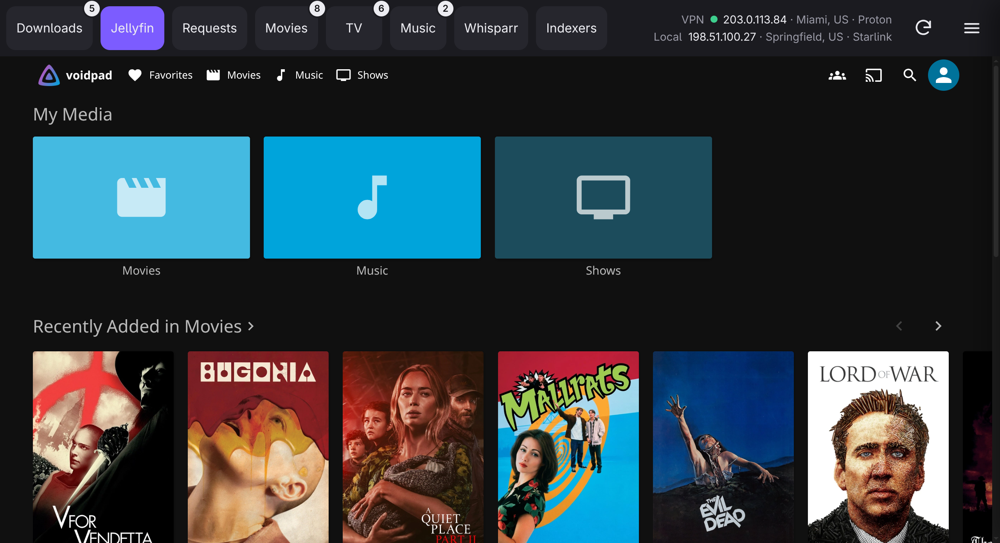
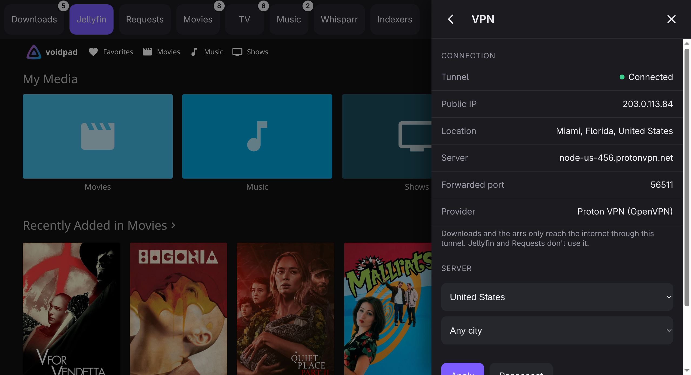

<p align="center">
  
</p>

<h1 align="center">Librarry</h1>

<p align="center">
  A touch-first home for your media stack: downloads, Jellyfin and the *arrs in one tabbed window, with every download routed through a VPN.
</p>

<p align="center">
  
  
  
  
  
  
  
</p>

<p align="center">
  
</p>

## What it is

Librarry is a small Electron shell around a container stack. Each app keeps its own web UI and gets a big, finger-sized tab:

| Tab | App | Behind the VPN |
| --- | --- | --- |
| Downloads | [Transmission](https://transmissionbt.com) with the [Flood](https://flood.js.org) UI | yes |
| Jellyfin | [Jellyfin](https://jellyfin.org) | no (reachable on your LAN / Tailscale) |
| Requests | [Seerr](https://github.com/seerr-team/seerr) | no |
| Movies, TV, Music, Whisparr | [Radarr](https://radarr.video), [Sonarr](https://sonarr.tv), [Lidarr](https://lidarr.audio), [Whisparr](https://github.com/Whisparr/Whisparr) | yes |
| Indexers | [Prowlarr](https://prowlarr.com) | yes |

The apps aren't bundled: they're pulled as container images from their own publishers and update independently.

- **VPN kill switch.** A [Gluetun](https://github.com/qdm12/gluetun) container holds the tunnel and every download app shares its network, so if the tunnel drops, their traffic stops. Port forwarding (Proton) is pushed into Transmission automatically.
- **Real IP checks.** The top bar shows your VPN and local public IPs, looked up live from inside the tunnel and from the machine itself, and flags it if they ever match.
- **Badges.** Each tab shows active downloads, queue sizes, errors and pending requests.
- **Menu.** The hamburger opens a sidebar with VPN status and server picker, plus per-app updates with one-tap update for each container.

<p align="center">
  
</p>

## Status

This is a personal build that runs on one Fedora tablet today. It works, but setup still means editing `stack/compose.yml` and `stack/.env` by hand. A setup wizard (folders, one admin account, VPN provider, optional public-tracker and FlareSolverr setup, import or restore of existing *arr libraries), AppImage and macOS packaging are planned next.

## Running it today (Linux)

Requirements: Podman (rootless, with `podman.socket` enabled) or Docker, `docker compose`, Node 20+, and a VPN account Gluetun supports.

```sh
git clone https://github.com/clomads/librarry && cd librarry
cp stack/.env.example stack/.env          # your VPN login
cp stack/vpn.env.example stack/vpn.env    # server country
$EDITOR stack/compose.yml                 # paths, timezone, provider
cd app && npm install && ./librarry-launch.sh
```

Opening the app starts the containers. Data lives in `~/media`; app configs in `~/.local/share/library-stack/`.

## Layout

```
app/      Electron shell (tabs, badges, sidebar)
stack/    compose file, stackctl.sh (up/down/status/update), vpnctl.py (Gluetun status, server choice, IP checks)
stack/migrate/   one-off tools used to move an existing Home Assistant *arr setup over
```

## License

[MIT](LICENSE)
